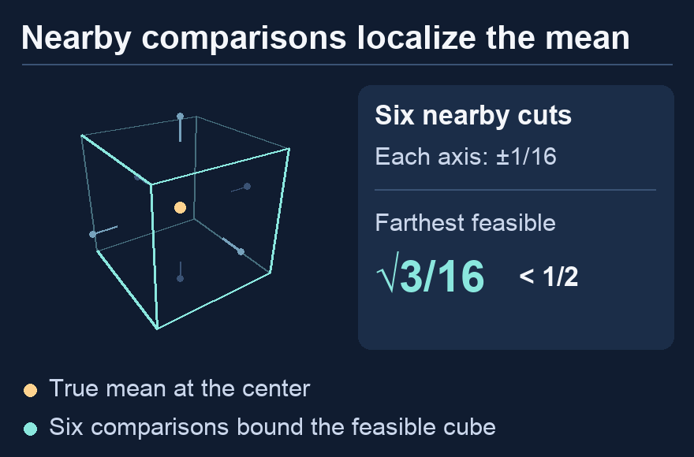

# Sharp minimax rates for Gaussian preference comparisons

   

For n observed pairs of independent N(θ,I) draws, each with a noiseless nearest-point label, the minimax expected Euclidean error on θ ∈ [−1,1]ᵈ is of order min{√(d/n), d√d/n}. This closes the dimension gap posed by Jourdan, Yüce and Flammarion in this Gaussian model. The transition occurs when n is of order d².

[Read the paper](paper/manuscript.pdf) · [LaTeX source](paper/manuscript.tex) · [Original question](https://arxiv.org/html/2505.23557v1#S5) · [Catalog Q598](https://github.com/10m-u/open-problems-catalog/blob/ca8d4d44ba3db527f19f28928c240168f545ecfe/problems/mathematics/mathematical-statistics.md#q598) · [Version DOI](https://doi.org/10.5281/zenodo.24572316)

## Explore the proof in 3D

Six comparisons with normals ±e₁, ±e₂ and ±e₃ cut the feasible displacements to [−1/16, 1/16]³, surrounding the true mean at zero. The farthest feasible displacement has length √3/16. Remove any one comparison in the explorer to see how an outward displacement of length 3/4 becomes feasible. The example is deterministic. In the statistical model, random comparisons close to the mean provide directional coverage.

[Download the offline explorer](https://raw.githubusercontent.com/DannyExperiments/gaussian-preference-minimax-rates/v1.0.0/visualization/nearby-comparison-explorer.zip) · [Explorer source](visualization/index.html) · [Worked geometry](proof/worked-cap-geometry.md) · [GIF rendering source](visualization/render.py)

## Why the proof works

The midpoint estimator gives the usual Gaussian rate √(d/n). For the faster regime, many comparison boundaries near the truth point in diverse directions. Hitting all constant-mass spherical caps confines the whole feasible set and gives d√d/n. The lower bound separates the Gaussian information in the pairs from the conditional information in their labels. A reference logistic predictor bounds the latter using an average over directions.

The original work gives the feasible-set method and the fixed-dimension acceleration. The manuscript credits the classical VC argument and the related Poisson geometry. [Source comparison](audits/public_safe_reports/LITERATURE.md).

## Reproduce the checks

    python3 -I scripts/verify_repository.py
    python3 -I verification/src/replay.py

The [recorded replay](verification/results/replay.txt) checks label-loss identities, the crossover and the worked example. See [scope](CLAIM_SCOPE_AND_LIMITATIONS.md), [reproducibility](REPRODUCIBILITY.md), and the [research disclosure](AI_DISCLOSURE.md).

## Cite

DannyExperiments. *Sharp minimax rates for Gaussian preference comparisons*. Version 1.0.0, 27 November 2026. [Version DOI](https://doi.org/10.5281/zenodo.24572316).
